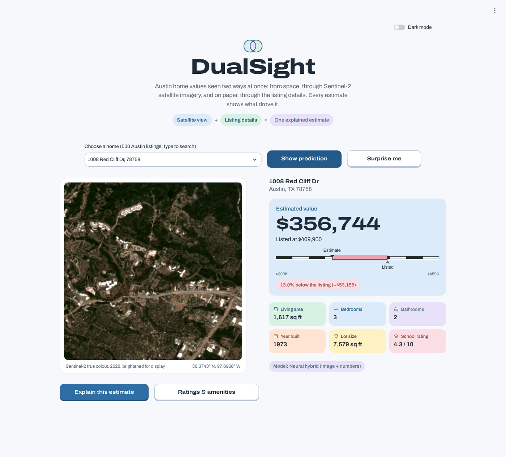
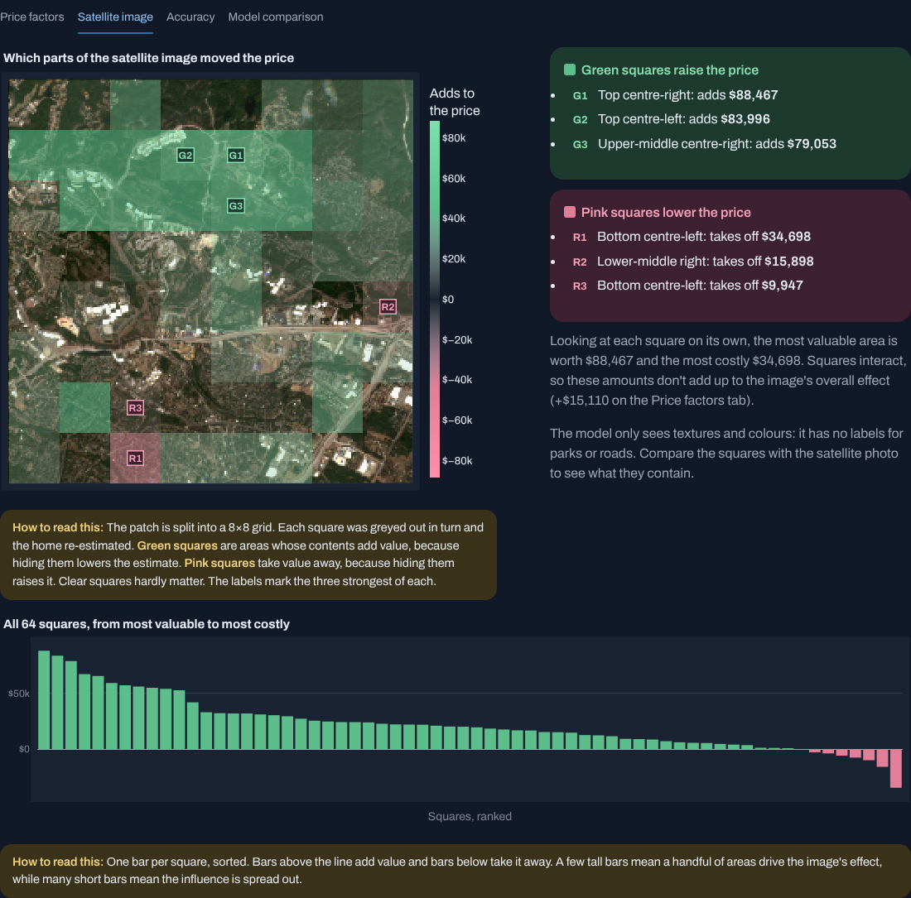
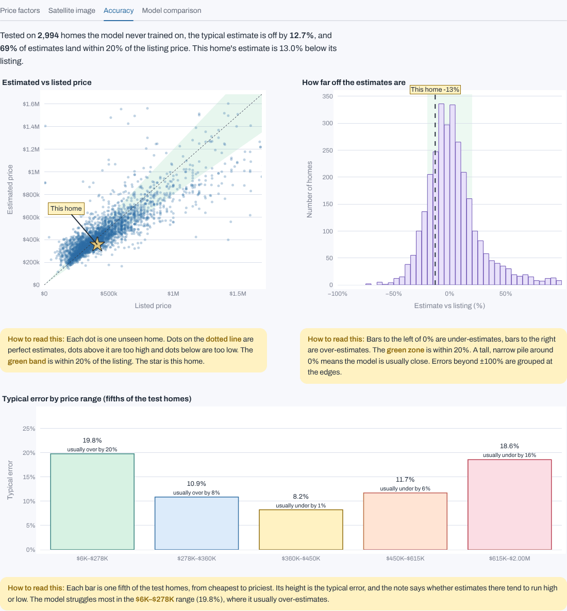

# DualSight

**Austin home values seen two ways at once.** DualSight estimates the price of a home in Austin, Texas from two sources together: a Sentinel-2 satellite image of the neighbourhood and the listing details (living area, bedrooms, bathrooms, year built, lot size, school rating). Every estimate comes with an explanation computed from the model itself.



## What it does

- **Estimates a home's price** with one of two hybrid models that read the satellite image and the listing numbers together.
- **Explains each estimate**:
  - a waterfall of how each factor moved the price
  - a map of which parts of the satellite image raised or lowered it
  - the model's accuracy on homes it never saw
- **Compares models** side by side on the same held-out test set.
- **Runs locally** as a Flask API with a Streamlit interface, in light and dark themes.

## Results

Scored on the same 2,994 held-out Austin homes, none of which were used in training:

| Model | Typical error | Within 20% of listing | Average miss |
| --- | --- | --- | --- |
| **Deep + boosting hybrid** (ResNet50 image features + numbers, gradient boosting) | **12.4%** | **69.9%** | **$87,430** |
| Neural hybrid (ResNet50 image branch + numeric branch, trained end to end) | 12.7% | 68.6% | $91,358 |
| Numbers only, no image (gradient boosting) | 15.7% | 59.8% | $107,345 |
| Image-only CNN (starting baseline) | 21.6% | 46.8% | $327,038 |

Adding the satellite image to the listing numbers cuts the typical error from 15.7% to 12.4%, so the view from space carries real information.



## How it works

**Two hybrid models**, trained in [`kaggle/aeroprice_kaggle_training.ipynb`](kaggle/aeroprice_kaggle_training.ipynb) on a free Kaggle GPU:

1. **Neural hybrid:** a ResNet50 image branch (ImageNet weights, last layers fine-tuned) and a dense numeric branch, fused and trained end to end on log(price).
2. **Deep + boosting hybrid:** ResNet50 image features compressed with PCA (32 components), combined with the raw numbers in a gradient-boosting model.

A smearing correction, measured on a validation split, removes the low bias that training on log(price) causes.

**Explanations** are computed from whichever model is active:

| Explanation | Method |
| --- | --- |
| Price factors | Exact TreeSHAP (boosting hybrid) or integrated gradients (neural hybrid). The steps add up exactly to the estimate. |
| Satellite image map | Occlusion: each square of an 8×8 grid is greyed out in turn and the home re-estimated. |
| Accuracy | Real held-out predictions, an error histogram and error by price range. |



## Project structure

```
backend/         Flask API (main.py) and model loading and explanations (model_service.py)
frontend/        Streamlit interface (app.py) and bundled Archivo font
pipeline/        Data pipeline, model definition, import, evaluation and prediction scripts
kaggle/          Training notebook for both hybrid models
.streamlit/      Theme settings
SETUP.md         Full setup guide (Windows, CPU-only laptop)
```

## Getting started

Full instructions are in [SETUP.md](SETUP.md). In short:

1. Create two Python 3.10 environments: `venv` from `requirements.txt` and `venv_ui` from `requirements_streamlit.txt`.
2. Download the data:
   - `austin_master_dataset.csv` and the image patches from [Kaggle](https://www.kaggle.com/datasets/sanveersinghsuneja/austin-satellite-property-data), into `data/`.
   - The original image-only model from [Hugging Face](https://huggingface.co/sanveer-singh/austin-property-predictor), into `models/`.
3. Add the hybrid models. Either:
   - download `aeroprice_trained_model.zip` from this repository's **Releases** page, or
   - train your own with the Kaggle notebook.

   Then import it:

   ```bash
   python pipeline/import_kaggle_model.py path/to/aeroprice_trained_model.zip
   ```
4. Start the backend and the interface:

   ```bash
   python backend/main.py
   streamlit run frontend/app.py
   ```

Model files and data are not stored in this repository because they exceed GitHub's file-size limit.

## Acknowledgements

DualSight started from the open-source [AeroPrice](https://github.com/sanveer-singh-suneja/AeroPrice) project, whose data pipeline, Sentinel-2 image patches and image-only baseline model it builds on. The setup steps above download that project's published dataset and baseline model.

Data and assets:
- Satellite imagery: Copernicus Sentinel-2
- Housing data: the Austin housing dataset via the Kaggle dataset above
- Font: [Archivo](https://github.com/Omnibus-Type/Archivo), SIL Open Font License (see `frontend/static/fonts/OFL-LICENSE.txt`)
